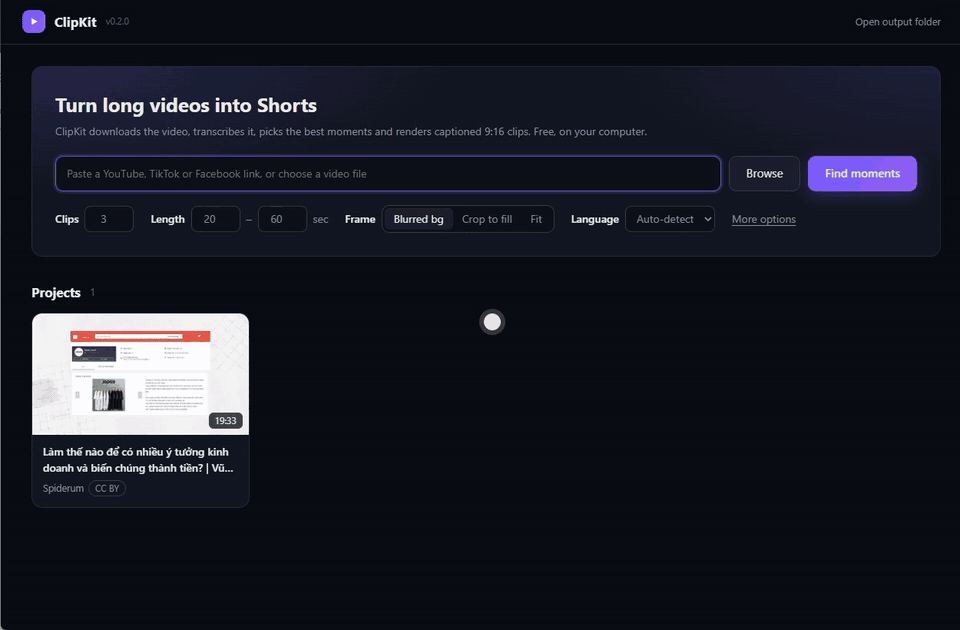
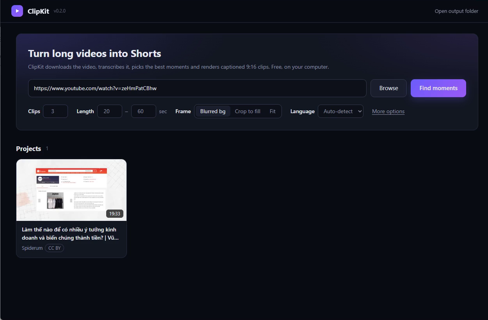
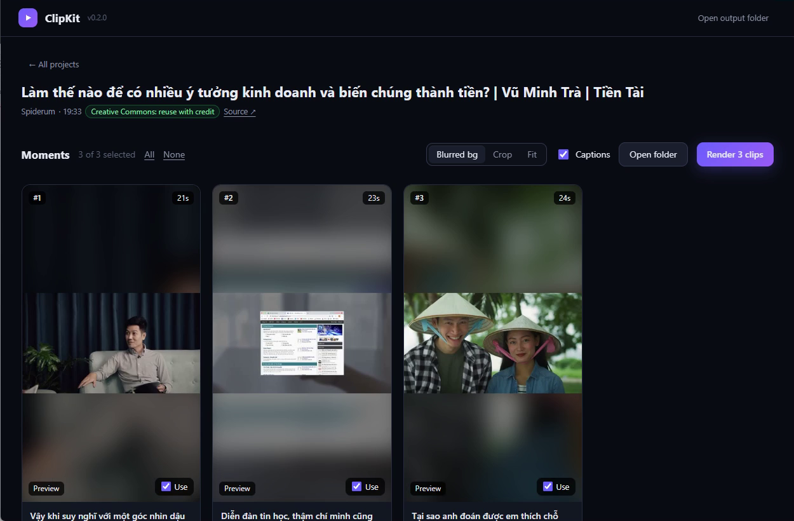
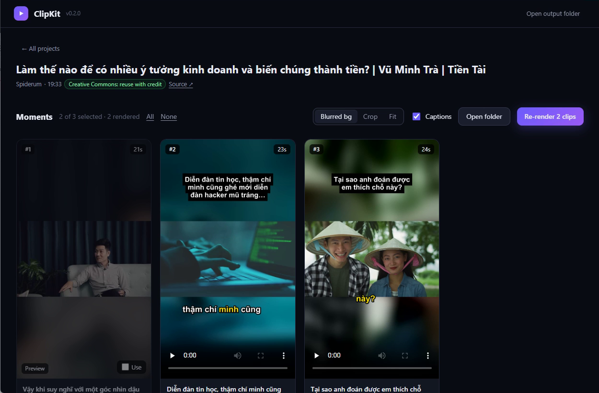

# ClipKit

Turn long videos (podcasts, interviews, lectures, talk shows) into **captioned 9:16 short clips** for YouTube Shorts, TikTok and Reels. Everything runs on your computer: no API key, no tokens, no upload.



- **Paste a link or pick a file.** yt-dlp downloads from YouTube, TikTok, Facebook and 1,000+ other sites.
- **Whisper** (faster-whisper) transcribes with word-level timing and handles Vietnamese well.
- **Finds the best moments** with a local scoring algorithm (hooks, pace, loudness, clean endings).
- **You review them** as cards: untick the ones you don't want, fix the times or the title.
- **FFmpeg renders** vertical clips with captions that highlight the word being spoken, plus a title. NVIDIA GPU encoding (NVENC) is used automatically when available.

Measured on a laptop with an i7-10750H + Quadro T1000: 6 minutes of Vietnamese video becomes 3 clips in about 6 minutes (Whisper `small` on CPU takes most of that; each clip renders in 12-19 s).

| Start a project | Review the moments | Watch the clips |
| :---: | :---: | :---: |
|  |  |  |

## Install

### Option 1: Download the installer (easiest)

1. Go to the [**Releases**](https://github.com/hiennv0298/ClipKit/releases/latest) page and download `ClipKit-Setup-<version>.exe` (or `ClipKit-<version>-portable.zip` if you'd rather not install).
2. Run it. No admin rights needed; ClipKit installs to `%LOCALAPPDATA%\Programs\ClipKit` with Python and FFmpeg included.
3. Open **ClipKit** from the Start menu or the desktop.

Tick "Add ClipKit to PATH" during setup to also get the `clipkit` command in a terminal.

> The installer is not code-signed yet, so Windows SmartScreen may warn you: click **More info → Run anyway**.

### Option 2: Command line

Requires Python 3.10+ (`winget install Python.Python.3.12`).

**Install once, with a Start menu shortcut and the `clipkit` command:**

```powershell
irm https://raw.githubusercontent.com/hiennv0298/ClipKit/main/scripts/install.ps1 | iex
```

To uninstall (from a clone of this repo):

```powershell
powershell -ExecutionPolicy Bypass -File scripts\install.ps1 -Uninstall
```

**Or run straight from the repo folder** (download the ZIP or `git clone`); dependencies are installed on first run:

```bat
run.cmd                                              :: opens the app window
run.cmd run "https://www.youtube.com/watch?v=..." -n 5
```

**Or with pip/pipx:** `pipx install git+https://github.com/hiennv0298/ClipKit`, then run `clipkit-gui` or `clipkit`.

## The app

The ClipKit window is a page served by ClipKit itself on `127.0.0.1` and shown in an Edge (or Chrome) app window, so it needs no extra install and works offline. Close the window to quit.

1. **Paste a link** (or **Browse** for a video file), set the number of clips and their length, pick the frame and press **Find moments**. *More options* has the speech model, a time range, captions and title switches and the output folder.
2. ClipKit downloads, transcribes and picks moments. Each moment is a card with a preview, the reasons it was picked and the transcript.
3. Press **▶** on a card to watch that moment from the original video. **Untick** the moments you don't want, edit the **title** or the **start/end** times, then press **Render**.
4. Rendered clips move to the top as each one finishes and play right in their cards. **Copy title & description** copies a ready-to-paste description with the source credit.

Projects stay in the list on the home screen, so you can come back, change the selection and render again. To clean up, hover a project and press the bin icon, or use the bin icon on a moment's card: files go to the Recycle Bin, and a video you picked from your computer is never deleted.

### Updates

ClipKit checks GitHub for a newer release once a day (no account, nothing about you is sent) and shows a notice with the release notes. Click the version in the header to check right away.

- **Installer version:** **Update now** downloads the new installer, checks it against the release's `SHA256SUMS.txt`, installs it over the current one and reopens ClipKit. Your projects, settings and Whisper models stay.
- **Portable zip:** **Download** opens the release page.
- **Command-line install:** the notice shows the command to run again.

After an update, a *What's new* window shows that version's notes once. Turn the daily check off under *More options*.

## Command line

```bash
clipkit                                                          # open the app window
clipkit run "https://www.youtube.com/watch?v=VIDEO_ID"           # 5 clips, 20-60 seconds each
clipkit run video.mp4 -n 8 --min 30 --max 60 --language vi       # local file
clipkit run "LINK" --section 10:00-30:00                         # only process part of the video
clipkit run "LINK" --layout crop --crop-x 0.4                    # fill the frame, shifted left
clipkit run "LINK" --model medium                                # more accurate captions, slower
clipkit render "C:\Users\you\Videos\ClipKit\video-name-abc123"   # re-render after editing segments.json
clipkit doctor                                                   # check FFmpeg and GPU
```

| Option | Default | Meaning |
| :--- | :--- | :--- |
| `-n, --clips` | 5 | Number of clips |
| `--min / --max` | 20 / 60 | Clip length in seconds |
| `--model` | small | `tiny`, `base`, `small`, `medium`, `large-v3`, `turbo` |
| `--language` | auto-detect | `vi`, `en`… setting it explicitly is more accurate |
| `--section` | whole video | e.g. `10:00-25:00` |
| `--layout` | blur | `blur` video centered on a blurred background · `crop` fill the frame · `fit` black bars |
| `--no-captions`, `--no-title`, `--uppercase` | | No captions, no title, uppercase captions |
| `--encoder` | auto | `nvenc` (NVIDIA GPU) or `cpu` |
| `--device` | auto | Run Whisper on `cuda` or `cpu` |
| `--selector` | heuristic | `llm` to let an AI model pick (see below) |
| `--cookies-from-browser` | | `chrome`/`edge`/`firefox` when the site requires login |

### Output

Everything goes to `Videos\ClipKit\<video-name>\` (change it in the app under *More options* or with `-o`):

| File | Contents |
| :--- | :--- |
| `clips/01_title.mp4` | 1080×1920 clip at the source frame rate, H.264 High, loudness normalized |
| `clips/01_title.srt` | Caption file to upload alongside the video |
| `clips/01_title.jpg` | Cover image |
| `clips/upload.txt` | Title, description and source credit for each clip |
| `transcript.json`, `segments.json` | Full transcript and the selected moments |

Running the same link again reuses the downloaded video and the transcript.

## Made for YouTube Shorts

The defaults follow YouTube's own guidance (checked November 2026):

- **Encoding** follows [YouTube's recommended upload settings](https://support.google.com/youtube/answer/1722171): H.264 High profile, 2 B-frames, a closed GOP of half the frame rate, about 8-12 Mbps, BT.709 color, AAC 48 kHz, `faststart`. The source frame rate is kept (25, 30, 60…) instead of being forced to 30.
- **Safe zones:** YouTube's title, channel name, Subscribe button and action buttons cover the bottom and right of a Short. Captions sit above the bottom ~520 px and away from the right-hand buttons; the title sits below the top bar.
- **Length:** Shorts can be up to 3 minutes, but [a Short over 1 minute with an active Content ID claim is blocked on YouTube and can't be monetized](https://support.google.com/youtube/answer/6013276) (claims can apply to some regions only). ClipKit defaults to 20-60 s and warns when you go longer.
- **`#shorts` is not needed** (length and aspect ratio decide), so `upload.txt` leaves hashtags to you; [up to 3 relevant ones](https://support.google.com/youtube/answer/6390658) show above the title.
- **Captions:** they are burned in and also written as `.srt`, which you can upload so viewers can switch them off.

### Copyright and monetization

ClipKit shows the video's license and warns when it is not Creative Commons.

- Only post clips of content you own, have permission for, or that is licensed **Creative Commons Attribution** (YouTube: Filters → Creative Commons). [CC BY needs credit](https://support.google.com/youtube/answer/2797468); *Copy title & description* includes it.
- The CC label is set **per video** by the uploader, not per channel: check each video (ClipKit saves the label it found in the project's `info.json`). Music or footage inside a CC video can still be claimed, and a CC license does not make plain clips eligible for monetization (see the next point).
- YouTube's [reused content policy](https://support.google.com/youtube/answer/1311392) does not monetize clips "edited together with little or no narrative", even with permission. Add your own value: commentary, context, analysis or a voice-over.
- In October 2026 YouTube said Shorts channels that mostly repost other people's clips get less reach ([Creator Insider](https://www.youtube.com/watch?v=XS2A6aExLaA)). Plan to add something original to each Short.

## How ClipKit picks moments

The transcript is split into sentences, then every window of consecutive sentences between the min and max length is scored on:

- **Speech density**: fast talking, few pauses.
- **Loudness**: parts louder than the video's average are usually the exciting ones.
- **Opening line**: questions, numbers and curiosity words ("why", "secret", "mistake", "money"… in Vietnamese and English) score higher; starting with a connective ("and", "but", "so"…) scores lower. Viewers decide in the first second or two whether to keep watching.
- **Ending on a complete sentence** and a length near the middle of the range.

The best non-overlapping windows are kept. This is fast and free but does not understand content the way a person does, which is why you review the moments before rendering.

### Optional: let an AI pick (`--selector llm`)

Works with any OpenAI-compatible API (OpenAI, DeepSeek, BytePlus ModelArk, OpenRouter, Ollama…). One request per video, capped by `CLIPKIT_LLM_MAX_TOKENS` (default 2000 response tokens).

```powershell
$env:CLIPKIT_LLM_BASE_URL = "https://ark.ap-southeast.bytepluses.com/api/v3"
$env:CLIPKIT_LLM_API_KEY  = "..."
$env:CLIPKIT_LLM_MODEL    = "deepseek-v4-1-flash-260910"
clipkit run "LINK" --selector llm
```

## Speed tips

- Whisper is the slowest step. `base` is about 2× faster than `small` but makes more spelling mistakes; process only the part you need with *Only process part of the video* / `--section`.
- **Whisper on an NVIDIA GPU** needs the CUDA 12 libraries (cuBLAS, cuDNN 9). Without them ClipKit falls back to the CPU and says so in the log.
- Rendering uses NVENC when an NVIDIA GPU is present.

Whisper models and the downloaded FFmpeg are stored in `%LOCALAPPDATA%\ClipKit` (Windows) or `~/.clipkit`.

## Development

```bash
python -m venv .venv && .venv\Scripts\activate
pip install -e ".[dev]"
pytest
clipkit            # the app
```

Build the Windows release (the installer needs [Inno Setup 6](https://jrsoftware.org/isinfo.php)):

```powershell
powershell -ExecutionPolicy Bypass -File scripts\build.ps1 -DownloadFfmpeg
```

This produces `dist\ClipKit-Setup-<ver>.exe` and `dist\ClipKit-<ver>-portable.zip`.

### Releasing a new version

1. Set the new version in `pyproject.toml`, `src/clipkit/__init__.py` and `installer/clipkit.iss`.
2. Add a `## <version>` section at the top of [`CHANGELOG.md`](CHANGELOG.md). Write it for users: it becomes the release text on GitHub and the *What's new* window in the app.
3. Commit, then push a tag: `git tag -a v<version> -m "ClipKit <version>"` and `git push origin v<version>`.

The **Release** workflow checks that the tag matches the version and that the changelog section exists, builds the installer and the portable zip, writes `SHA256SUMS.txt`, and publishes all three with the notes. Installed copies see the update within a day.

```
src/clipkit/
  gui.py         the app: local web server, JSON API, app window
  updates.py     checks GitHub Releases, downloads, verifies and installs updates
  webui/         the app's page (HTML, CSS, JS in one file, no dependencies)
  cli.py         run / render / gui / doctor commands
  pipeline.py    ties the steps together, caches results for fast re-runs
  download.py    yt-dlp, license detection
  transcribe.py  faster-whisper, loudness profile
  select.py      moment scoring and selection
  llm.py         AI-based selection via API (optional)
  captions.py    ASS captions with per-word highlight, SRT
  render.py      FFmpeg: 9:16 framing, YouTube-friendly H.264, loudness normalization
  deps.py        find or download FFmpeg, GPU checks
```

MIT License.
